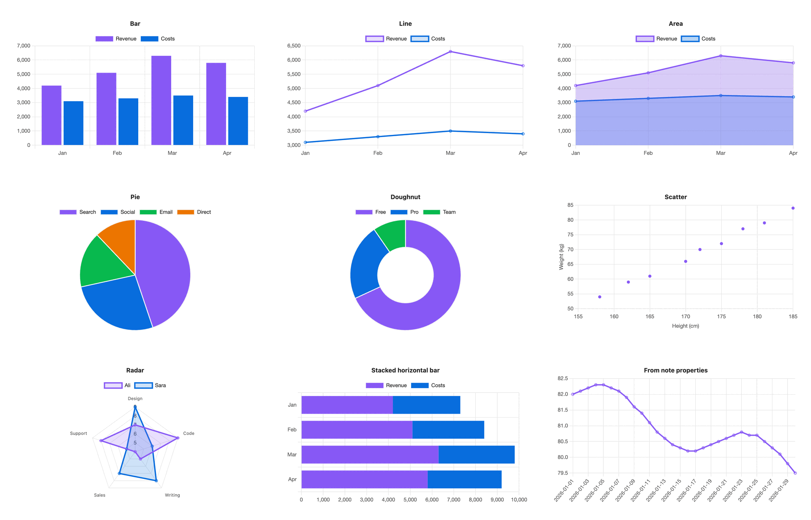

# S-Charts

See how it works and how to install it: **[abdulkader-safi.github.io/obsidian-s-chart-plugins](https://abdulkader-safi.github.io/obsidian-s-chart-plugins/)**

An Obsidian plugin that draws charts from a markdown table inside a code block, or from the properties of many notes. Charts use your theme's colours and redraw when you switch theme or light and dark mode.

The data stays plain text in your note. The plugin never edits notes and makes no network requests.

Status: in development and not yet released. Progress is tracked in [PROGRESS.md](PROGRESS.md).

## Your first chart

Run **Insert chart** from the command palette, or type this into a note:

````markdown
```s-chart
type: bar
title: Monthly revenue
---
| Month | Revenue | Costs |
| ----- | ------- | ----- |
| Jan   | 4200    | 3100  |
| Feb   | 5100    | 3300  |
| Mar   | 6300    | 3500  |
```
````

The lines above `---` set up the chart. The table below it is the data. The first column holds the labels, and each other column is one series, named by its header. Add a `Profit` column and you get a third series.

To change a chart in live preview, hover over it and select the `</>` button in its top-right corner, or move the cursor into it with the arrow keys. Reading view has no edit button for rendered blocks, so switch to live preview first.

## Chart types

`bar`, `line`, `area`, `pie`, `doughnut`, `scatter` and `radar`. Every chart below was drawn by the plugin in Obsidian's default theme.

<picture>
  <source media="(prefers-color-scheme: dark)" srcset="docs/img/gallery-dark.png">
  
</picture>

- Pie and doughnut use the first series and say so when the table has more.
- Scatter needs numbers in the first column: it is the x axis.

## Settings lines

| Key | Values | Default |
|-----|--------|---------|
| `type` | one of the chart types | required |
| `title` | any text | none |
| `palette` | a palette name from settings | the default palette |
| `colors` | hex colours, comma separated: `#e11d48, #0ea5e9` | none |
| `height` | pixels, 120 to 1200 | 300, or the setting |
| `stacked` | `true` or `false` | `false` |
| `horizontal` | `true` or `false`, bar charts only | `false` |
| `legend` | `top`, `bottom` or `none` | `top`, or `none` for one series |
| `x-label`, `y-label` | axis titles | none |
| `source`, `x`, `y` | see "Charts from properties" | none |

A key the plugin doesn't know shows a warning under the chart, with a suggestion when it is close to a real one: `pallet` gives "did you mean palette?". The chart still draws.

## Numbers

Cells can hold `4200`, `4,200`, `$4,200`, `KWD 4,200`, `42%` or `-3.5`. Currency symbols, three-letter currency codes, thousands commas and `%` are dropped. An empty cell leaves a gap in the series rather than drawing a zero.

Tooltips format numbers for your system's locale, so hovering Feb in the example shows "Feb, Revenue: 5,100".

## Colours

With nothing set, series take the theme's accent colour first, then the theme's other named colours in a fixed order (blue, green, orange, purple, red, cyan, yellow, pink). Axis text, grid lines and the font come from the theme too.

To use your own colours:

1. Open **Settings → S-Charts** and select **Add palette**.
2. Name it, for example `brand`, and set each colour with the picker or a hex code. A palette holds 1 to 12 colours, and a colour can also be a theme variable such as `var(--color-accent)`.
3. Add `palette: brand` to a chart.

Series take the palette's colours in order and start again from the first when there are more series than colours. Pick a palette as **Default palette** to colour every chart that has no `palette` line. A `colors:` line overrides both for one chart.

A palette name that doesn't exist falls back to theme colours with the notice "Palette 'x' not found, using theme colours."

Editing a palette redraws the open charts that use it.

## Charts from properties

Leave out the table and point the chart at notes instead:

````markdown
```s-chart
type: line
title: Weight
source: "#daily"
x: date
y: weight
```
````

- `source` is a tag such as `"#daily"` (nested tags like `#daily/work` count) or a folder path such as `Journal/2026`.
- `x` is the property for the x axis. Rows are sorted by it, so dates in `YYYY-MM-DD` form come out in order.
- `y` is one property, or several separated by commas: `y: weight, steps`.

Notes without the `x` property are skipped, and the chart says how many. Change a property in any matching note and the chart updates within half a second.

## When something is wrong

A block the plugin can't read shows the line and the problem instead of a chart, for example "Line 1: unknown type "bars". Use bar, line, area, pie, doughnut, scatter or radar." It never leaves a blank space.

## PDF export

Charts come out fully drawn in **Export to PDF**, scaled to the page width, at twice the screen's pixel density. Animation is always off while exporting.

## Settings

The settings tab holds the default palette (Theme, or one of your palettes), the default height (120 to 1200 pixels, 300 to start), an animations switch, and the palette editor. Deleting a palette asks first.

## Privacy

Everything runs on your device. No network requests, no telemetry. The plugin reads your notes through Obsidian and writes only its own settings file.

## Development

```bash
npm install
npm run dev     # watch build
npm test        # unit tests, needs Node 22.18 or later
npm run lint
npm run build
```

`test-vault/` holds a note per chart type, a note per error, 30 dated notes for properties charts, a 500-row stress note and a PDF test note. Copy it into a vault folder named `S-Charts test`. `node tests/make-notes.mjs <folder> <count>` writes more dated notes.

The site is the static page in [docs/](docs), served by GitHub Pages from the `master` branch. The design is written up in [spec](spec). Start with [06-build-spec.md](spec/06-build-spec.md).

## Licence

MIT
